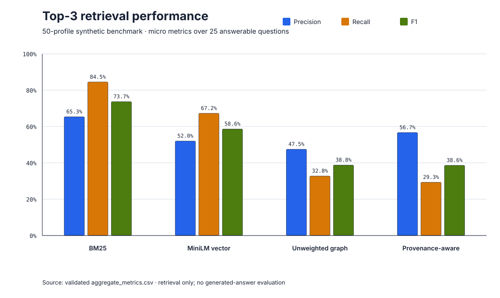

# Provenance-Aware Graph Retrieval

## 1. Project problem

Retrieval systems can surface plausible records without establishing whether a graph path is supported by the source profile, whether two similar names refer to the same person, or whether a generic concept created a weak connection. This project asks a narrow, auditable question: how do lexical, dense-vector, unweighted-graph, and provenance-filtered graph retrieval compare when every result must resolve to a ranked Source ID?

## 2. What was implemented

Package B is a deterministic, locally executable retrieval benchmark with one shared Top-3 contract:

- Okapi BM25 lexical retrieval (`bm25_v1`);
- MiniLM dense retrieval (`minilm_vector_v1`), representing the retrieval stage of a Vector RAG pipeline—not a complete RAG system;
- deterministic breadth-first unweighted graph retrieval (`unweighted_graph_v1`);
- deterministic graph retrieval with source-evidence, generic-concept, and identity-collision filtering (`provenance_graph_v1`).

Shared loaders, schemas, metrics, retrieval text, cache handling, provenance traces, and a 22-test regression suite make the comparison inspectable and reproducible.

## 3. Dataset disclosure

All 50 Source profiles are synthetic test fixtures. They do not describe real people or production users. The frozen benchmark contains 118 nodes, 116 directed edges, 30 fixed questions, 58 gold Source-ID assignments, 25 answerable questions, and five empty-gold abstention questions.

The authoritative executable-v1 fingerprints for `data/test_graph_slice.json` are:

- raw SHA-256: `bd6c8802a864b4599c064d34c01a5d8b460cb4f040bd8339f745bef8dcf61ad5`;
- canonical JSON SHA-256: `cfa22f31d1d0186f6f54119c5be0597f88b94c6fa4a1db8c39cef4c975c7f498`.

An older documented checksum beginning `1616fb0` is not present in this checkout. The discrepancy is recorded in the [benchmark integrity report](docs/benchmark_integrity_report.md); the data was not modified to recreate it.

## 4. Benchmark design

The current run is a preregistered exploratory portfolio benchmark v1, not a confirmatory scientific study. The algorithms, thresholds, field selection, dataset, questions, gold labels, and Top-3 cutoff were frozen before the 120 current outputs were generated, although the dataset and gold labels already existed.

All four methods retrieve Source IDs for the same questions. The benchmark evaluates retrieval—not generated-answer quality. Empty-gold questions use abstention correctness as their primary outcome and are excluded from macro retrieval averages. Exact rules are in [algorithm preregistration v1](docs/algorithm_preregistration_v1.md).

The repository also contains an earlier 30-profile developmental pilot. Its stored predictions, dataset, and implementations differ from the current benchmark and are not reused as v1 results.

## 5. Observed results

Micro retrieval metrics below use the 25 answerable questions; correct abstentions use the five empty-gold questions.

| Method | TP | FP | FN | Precision | Recall | F1 | Correct abstentions |
|---|---:|---:|---:|---:|---:|---:|---:|
| BM25 | 49 | 26 | 9 | 65.3% | 84.5% | 73.7% | 0/5 |
| MiniLM vector | 39 | 36 | 19 | 52.0% | 67.2% | 58.6% | 0/5 |
| Unweighted graph | 19 | 21 | 39 | 47.5% | 32.8% | 38.8% | 5/5 |
| Provenance-aware graph | 17 | 13 | 41 | 56.7% | 29.3% | 38.6% | 5/5 |



The complete outputs are in [the validated v1 result directory](results/codex_benchmark_v1_20260824_204717/).

## 6. Interpretation

BM25 achieved the highest F1 on this small, entity-heavy synthetic benchmark. Provenance filtering reduced graph false positives from 21 to 13 and raised precision from 47.5% to 56.7%, but it also reduced true positives and recall. Its F1 did not improve over the unweighted graph baseline. Both graph methods correctly abstained on all five unanswerable questions; neither text method did.

These results show a precision–recall trade-off, not general superiority. Five abstention questions are too few for broad abstention claims.

## 7. Architecture and workflow

```text
Frozen profiles + graph + questions + gold labels
                    |
          shared validated loader
                    |
    +---------------+----------------+-------------------+
    |               |                |                   |
   BM25       MiniLM vectors   unweighted BFS   provenance filtering
    |               |                |                   |
    +---------------+----------------+-------------------+
                    |
        ranked Top-3 Source IDs + traces
                    |
         shared metrics and reports
```

BM25 and MiniLM use identical evidence-bearing profile text. The graph methods use the frozen edges and deterministic seed/traversal rules; the provenance method additionally validates paths against direct profile evidence and records exclusions.

## 8. Reproduction

Use Python 3.12 in a fresh environment:

```bash
python3.12 -m venv .venv-benchmark
source .venv-benchmark/bin/activate
python -m pip install -r requirements-benchmark.txt

HF_HOME="$PWD/.cache/huggingface" \
  python -m unittest discover -v

HF_HOME="$PWD/.cache/huggingface" \
  python scripts/run_benchmark.py
```

On Windows PowerShell, activate with `.venv-benchmark\Scripts\Activate.ps1`; the remaining `python` commands are unchanged (set `$env:HF_HOME="$PWD\.cache\huggingface"` first).

The first MiniLM run downloads the pinned `sentence-transformers/all-MiniLM-L6-v2` revision and therefore requires network access. It uses no paid API. To regenerate the charts from a result CSV:

```bash
python scripts/generate_result_charts.py \
  --input results/codex_benchmark_v1_20260824_204717/aggregate_metrics.csv \
  --output-dir docs/assets
```

## 9. Repository structure

| Path | Purpose |
|---|---|
| `data/test_graph_slice.json` | Frozen synthetic graph and Source profiles |
| `data/workbooks/`, `data/csv/` | Frozen questions, gold labels, original matrix, and pilot artifacts |
| `retrieval_benchmark/` | Shared benchmark code and four retrievers |
| `scripts/run_benchmark.py` | Executes the 120-row benchmark |
| `scripts/generate_result_charts.py` | Rebuilds SVG charts from aggregate CSV |
| `tests/` | Integrity and behavioral tests |
| `docs/` | Preregistration, integrity evidence, methodology, and chart assets |
| `results/codex_benchmark_v1_20260824_204717/` | Frozen validated v1 outputs and reports |
| `demo/` | Earlier interactive portfolio prototype |

## 10. Limitations

- Synthetic data may not reflect entity ambiguity, language, graph topology, or evidence quality in real organizational data.
- This benchmark does not evaluate generated answers, answer grounding, or a complete GraphRAG system.
- The 30 questions and five abstention cases are small and were not a held-out confirmatory study.
- Local latency measurements on this small benchmark are not evidence of production scalability.
- API cost was `$0.00`; local compute, electricity, and hardware cost were not monetized.
- The methods are fixed transparent baselines, not production-ready retrieval systems.
- Results should not be generalized to authorized non-synthetic or cross-domain graphs.

## 11. Project Attribution

This repository originated from a team-based University of Washington Master of Science in Information Management practicum sponsored by LumIntelligence, with Peter Wang serving as the project sponsor. The practicum team developed the original methodology, prototype design, frozen synthetic evaluation artifacts, and final report.

Yijie Ren’s documented contributions included integrating the evidence-first retrieval benchmark, designing the experimental and evaluation framework, analyzing results, developing prototypes, and translating technical findings into recommendations.

The executable Package B v1 benchmark presented in this repository was completed as a post-practicum extension of the team’s frozen evaluation artifacts. It implements and independently reproduces four preregistered retrieval methods across all 120 method–question combinations.

All 50 donor profiles used in the benchmark are synthetic test data. They do not represent real donors, customers, or production records. The repository contains no proprietary production graph, and the reported results should not be interpreted as production validation or as an endorsement by LumIntelligence.

In this post-practicum extension, I extended the team’s frozen evaluation design into a reproducible four-method benchmark, preregistered the implementation rules, validated all 120 runs, and analyzed the resulting precision–recall and abstention trade-offs.

See [RELEASE_NOTES_v1.md](RELEASE_NOTES_v1.md) for the release boundary and [NOTICE.md](NOTICE.md) for publication context.
