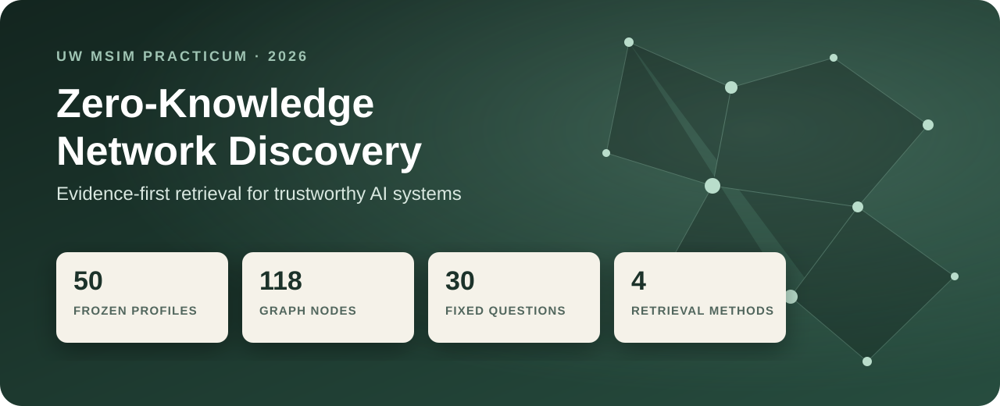
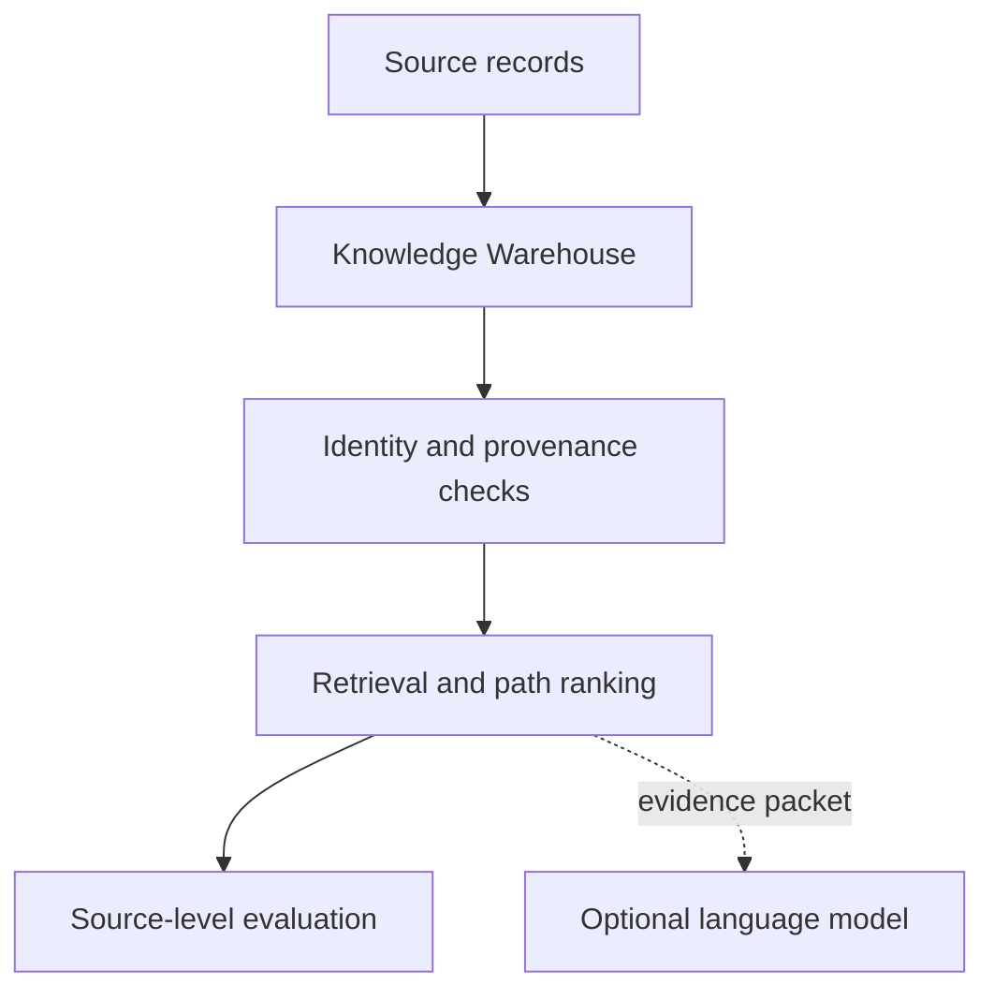

<div align="center">
  
</div>

# Zero-Knowledge Network Discovery for AI Systems

**An Evidence-First Benchmark for Trustworthy AI Retrieval**

A reproducible methodology for deciding which automatically discovered graph relationships should be allowed to influence an AI system.

This repository is the public portfolio version of a University of Washington MSIM practicum completed by a four-person team with LumIntelligence. It is organized for two audiences: a concise decision story for product and strategy reviewers, with auditable data and scripts for technical reviewers.

## Why this project matters

Retrieval can find relevant text without resolving whether two names represent the same person, whether a graph edge is supported by direct evidence, or whether a broad semantic hub is creating plausible but weak paths. The project therefore treats hallucination partly as an information-organization problem and separates:

- source evidence from inferred relationships;
- canonical identity from display names;
- retrieval behavior from generated language;
- completed results from proposed system features.

## Portfolio at a glance

| Deliverable | Scope | Status |
|---|---:|---|
| Completed pilot | 30 synthetic profiles, 30 questions, 3 baselines | Recomputed and documented |
| Frozen graph slice | 50 synthetic profiles, 118 nodes, 116 edges | Hash-verified and structurally audited |
| Final evaluation matrix | 30 questions × 4 methods = 120 rows | Ready; all outputs `NOT_RUN` |
| Interactive prototype | Four-stage network and evidence view | Included in `demo/` |
| Confidence-aware retrieval | Transparent scoring and threshold design | Proposed, not calibrated |

## Verified pilot finding

On the completed 30-source synthetic pilot, Graph Entity retrieval reduced false positives from 60–61 to 28 while recovering all 30 gold labels.

| Method | TP | FP | FN | Precision | Recall | F1 | Negative abstention |
|---|---:|---:|---:|---:|---:|---:|---:|
| Keyword-IDF@3 | 29 | 61 | 1 | 32.2% | 96.7% | 48.3% | 0.0% |
| TF-IDF Vector@3 | 30 | 60 | 0 | 33.3% | 100.0% | 50.0% | 0.0% |
| Graph Entity@3 | 30 | 28 | 0 | 51.7% | 100.0% | 68.2% | 40.0% |

These values are recomputed from the included predictions and gold labels. A [validation note](docs/validation-notes.md) records a corrected inconsistency in an earlier presentation draft.

## System design



The architecture combines a canonical Knowledge Warehouse, evidence-based routing, a proposed confidence layer, and network/evaluation metrics. Full rationale and decision rules are in [Methodology](docs/methodology.md).

## What is included

| Path | Contents |
|---|---|
| `data/test_graph_slice.json` | Frozen 50-source node-link graph |
| `data/workbooks/` | Completed pilot workbook and final calculation-ready matrix |
| `data/csv/` | Reviewable CSV exports used by the verification scripts |
| `demo/index.html` | Interactive four-stage network prototype |
| `scripts/audit_graph.py` | Graph integrity, topology, concentration, and hash audit |
| `scripts/evaluate_pilot.py` | Recomputes Source-level pilot metrics |
| `scripts/verify_release.py` | Enforces the public claim boundary and frozen counts |
| `docs/` | Methodology, results, data dictionary, and validation notes |

The 367 MB original graph is intentionally excluded. The public portfolio uses the smaller frozen slice that reviewers can inspect and reproduce.

## Reproduce the checks

Python 3.10+ is sufficient; the scripts use only the standard library.

```bash
python3 scripts/audit_graph.py
python3 scripts/evaluate_pilot.py
python3 scripts/verify_release.py
```

To view the prototype, open `demo/index.html` in a browser. It loads D3.js from cdnjs.

## Current claim boundary

The 50-source matrix is frozen and calculation-ready, but none of its four retrieval methods has been executed in this package. No 50-source winner is claimed. Confidence-weighted edges are also a proposed extension: all 116 frozen graph edges currently lack a calibrated confidence field.

The project supports a controlled retrieval comparison and a sponsor handoff package. It does not establish generated-answer faithfulness, production privacy or security, cross-domain generalization, or production readiness.

## My contribution

My portfolio focus is the translation layer between AI research and an auditable product decision: narrowing the sponsor's broad trust problem, integrating the team's methodology, constructing and documenting the evaluation package, explaining the metrics and claim boundaries, developing the prototype narrative, and leading the final report and handoff presentation.

## Project context

- **Program:** University of Washington, Master of Science in Information Management
- **Format:** Sponsored Industry Practicum, four-person team
- **Partner:** LumIntelligence
- **Sponsor:** Peter Wang
- **Completed:** August 2026

All donor profiles are synthetic test fixtures. See [Public portfolio notice](NOTICE.md) for data and publication boundaries.
