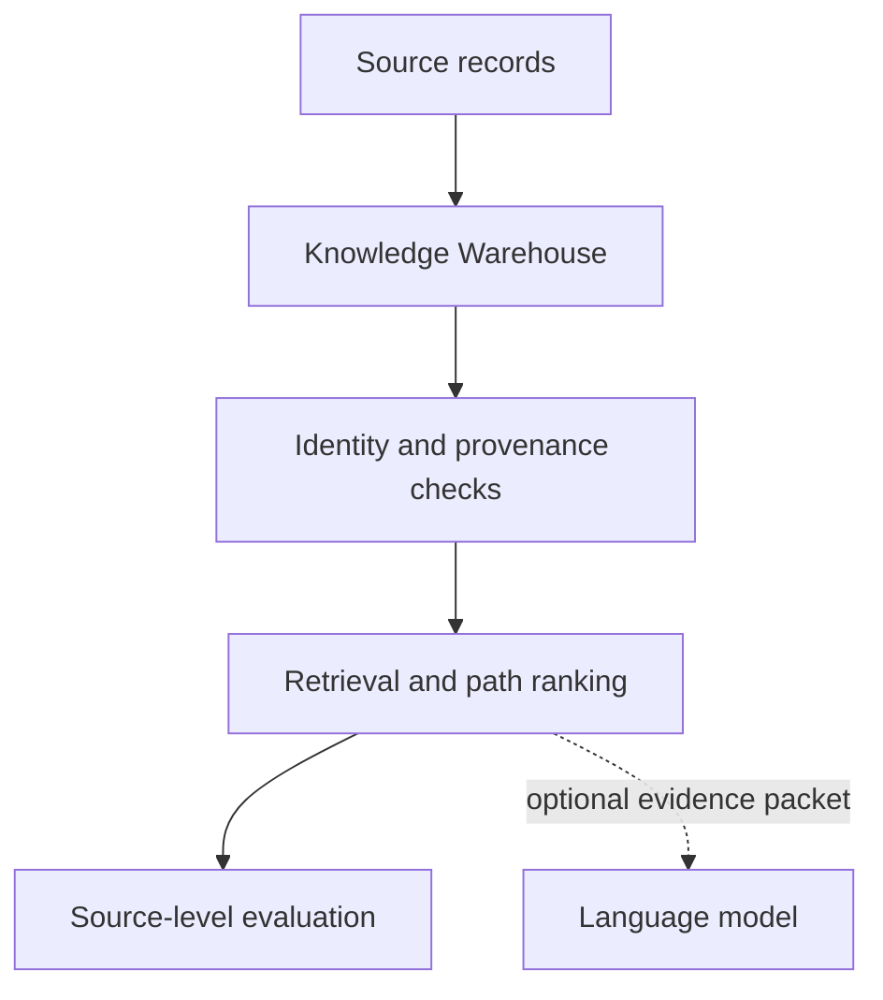

# Methodology

## Research question

How can an AI system discover and retrieve useful relationships from fragmented information while keeping source evidence, inferred structure, and uncertainty distinguishable?

The project treats hallucination partly as an information-organization problem. Retrieval can surface relevant text, but relevance alone does not resolve duplicate identities, unsupported relationships, missing provenance, or overly broad semantic hubs.

## Evidence-first architecture

The design separates four responsibilities:

1. **Knowledge Warehouse** — preserves source-specific records while linking them to reviewable canonical entities.
2. **Evidence-Based Routing** — admits, rejects, or down-ranks paths according to traceable source support.
3. **Confidence-Weighted Edges** — a proposed uncertainty layer for calibrated relationship scores and threshold decisions.
4. **Network Metrics** — evaluates graph integrity, retrieval quality, abstention, latency, and cost.

Confidence is a design contribution, not a completed result. The frozen graph contains triggers and structure, but none of its 116 edges has a calibrated confidence field.

## Controlled evaluation design

The final benchmark freezes the following before any method outputs are entered:

- 50 synthetic source profiles;
- a 118-node, 116-edge directed graph slice;
- 30 questions: 25 answerable and 5 requiring abstention;
- gold Source IDs with one to three relevant sources per answerable question;
- a common Top-3 output contract;
- four methods: Keyword Search, Vector RAG, Unweighted Graph Retrieval, and Provenance-Aware Graph Retrieval.

For answerable questions:

- **TP**: returned Source IDs contained in the gold set;
- **FP**: returned Source IDs outside the gold set;
- **FN**: gold Source IDs missing from the Top-3;
- **Precision**: `TP / (TP + FP)`;
- **Recall**: `TP / (TP + FN)`;
- **F1**: harmonic mean of precision and recall.

For empty-gold questions, correct behavior is an explicit abstention.

## Why source-level scoring

The project stops at evidence retrieval before evaluating generated prose. This prevents a fluent answer from hiding unsupported retrieval. Answer-level faithfulness remains a later phase after the retrieval layer is validated.

## Decision rule

Provenance-aware retrieval should advance only if it improves precision, F1, abstention, or collision-case behavior without unacceptable recall loss or operational cost. If duplicate-name collisions dominate errors across graph methods, entity resolution should be fixed before adding ranking complexity.
